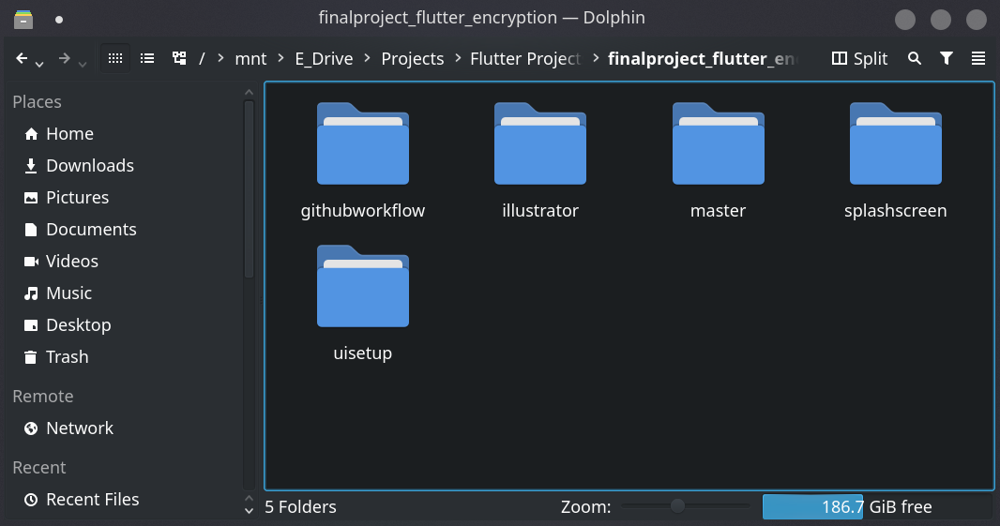

# Github Workflow

## Explorer Workflow Pic
 

## Github Sign In Commands

<pre>
Config Username: git config --global user.name "wilcywilson"
Config email: git config --global user.email wilsonshresthaxxxxxx@gmail.com
</pre>

## Commands to get started

<pre>
git init (initialization)
git remote add origin https://github.com/WilcyWilson/7thSem-FinalProject-EncryptionApp (origin github link)
git pull origin branchname(git pull remote branch )
git branch (list branches in repo)
git checkout branchname
git status (displays changes made to the branch)
git add . (adds changes)
git commit -m ""  (commits changes)
git push -u origin branchname (push to current branch)

Now, to add a different branch make a different folder to make things easier. And, repeat the above steps.
To push to branch next time just type "git push"
New Folder for every new branch
</pre>

## Setting Up a New Extending Branch (Preferably in a new folder in pc to make things easy)

<pre>
git init
git remote add origin https://github.com/WilcyWilson/7thSem-FinalProject-EncryptionApp
git pull origin splashscreen (Pulling the branch you want to add new features to.)
git checkout -b uisetup (Creates a new branch which will base it off the HEAD of current branch i.e. splashscreen.)
git branch (To check your current branch and available branches)
git push -u origin uisetup (Makes uisetup branch as upstream)

After this new branch will be created in the github website too.
</pre>

## Setting Up a New Empty Branch (Preferably in a new folder in pc to make things easy)

<pre>
git init
git remote add origin https://github.com/WilcyWilson/7thSem-FinalProject-EncryptionApp
git checkout --orphan NEWBRANCH (Creating Empty Branch)
Add files and changes.
git add .
git commit -m "commit for empty branch"
git push -u origin NEWBRANCH (Makes NEWBRANCH branch as upstream)
git pull (get remote branches info)

After this new branch will be created in the github website too.
</pre>

## Hard Reseting to head

<pre>
git reset --hard

This will reset our project to the previous head at the remote repo.
</pre>

## Delete a Git Branch

#### Locally
<pre>
git branch -d branchname
</pre>

#### Remote Branch
<pre>
git push origin --delete branchname
</pre>

## Discard Untracked Uncommited files using git
<pre>
git restore <filename> (discard local, uncommitted changes and return a single file to its last committed state)
git restore --staged <filename> (unstage a file and move it back to "modified" status)
git restore --source <commit_hash> <filename> (To restore a file to its state from a specific historical commit)
</pre>

## Concise command that shows a list of previous commits and their hashes to identify a rollback target
<pre>
git log --oneline
</pre>

## Discards all local changes to all tracked files in the current directory at once
<pre>
git checkout .
</pre>

## Bulk removal of untracked files from the working directory
<pre>
git clean
git clean -f (git clean require the -f (force) flag by default to prevent the accidental permanent deletion of files that are not stored in Git's history)
</pre>

